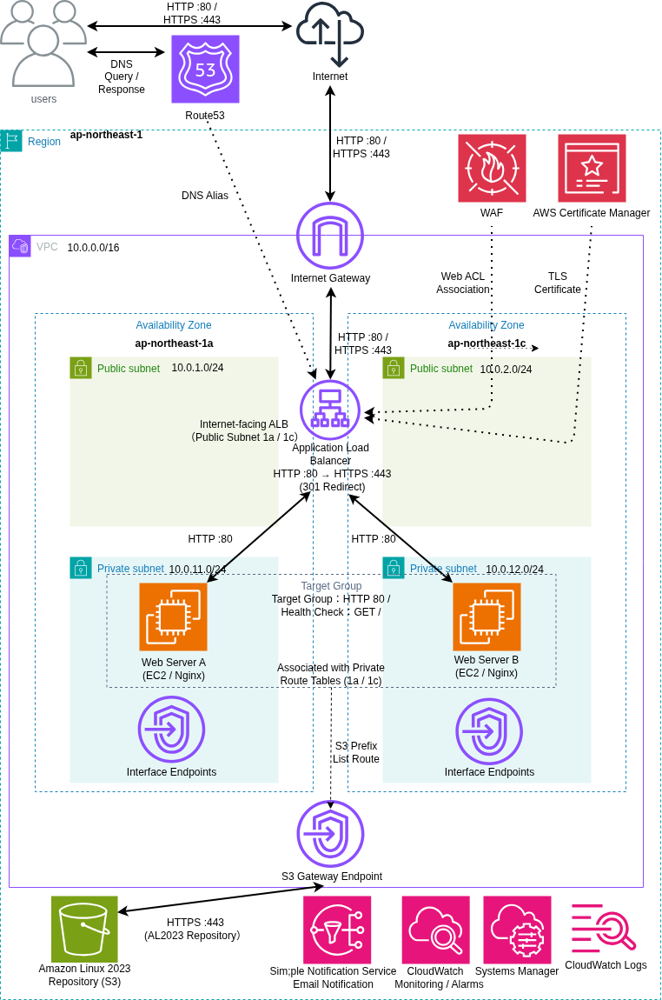

# AWS Multi-AZ Web Infrastructure Portfolio

## 1. プロジェクト概要

AWS上に、高可用性・セキュリティ・運用性を考慮したWebインフラ環境を構築したポートフォリオです。

AWSの主要サービスを組み合わせ、異なるアベイラビリティゾーン（AZ）にWebサーバーを配置することで、障害発生時にもサービスを継続できる構成を目指しました。

最初にAWSマネジメントコンソールやCLIを利用して手動構築を行い、各サービスの動作を確認しました。

その後、TerraformによるInfrastructure as Code（IaC）を実装し、インフラ構成のコード化・再現性の向上に取り組みました。

また、Webサーバーを意図的に停止する障害試験を実施し、ALBによる異常検知、Auto Scaling Groupによる自動復旧、正常なWebサーバーによるサービス継続を検証しました。

### 構築の目的

- AWSを利用したインフラ設計・構築の実践
- Multi-AZ構成による高可用性の実現
- セキュリティを考慮したネットワーク設計
- CloudWatchによる監視・ログ管理
- TerraformによるIaCの実践
- 障害試験を通じた自動復旧の検証

---

## 2. AWS構成図



リージョン：ap-northeast-1（東京）

アベイラビリティゾーン：
- ap-northeast-1a
- ap-northeast-1c

インターネットからのアクセスは、Route 53を経由してALBに振り分けられます。

ALBでHTTPS通信を終端し、Private Subnet内のEC2（Nginx）へHTTP通信でリクエストを転送します。

EC2はAuto Scaling Groupで管理し、異なるAZに2台配置しています。

---

## 3. 使用技術

| 分類 | 使用技術 |
|---|---|
| クラウド | AWS |
| IaC | Terraform |
| OS | Amazon Linux 2023 |
| Webサーバー | Nginx |
| ネットワーク | VPC、Subnet、Route Table、Internet Gateway |
| 負荷分散 | Application Load Balancer |
| 高可用性 | Auto Scaling Group、Multi-AZ |
| DNS | Amazon Route 53 |
| SSL/TLS | AWS Certificate Manager |
| セキュリティ | AWS WAF、Security Group、IAM |
| サーバー管理 | AWS Systems Manager Session Manager |
| プライベート通信 | VPC Endpoint |
| 監視 | Amazon CloudWatch |
| 通知 | Amazon SNS |
| ログ保存 | CloudWatch Logs、Amazon S3 |
| バージョン管理 | Git、GitHub |

---

## 4. システム構成

### ネットワーク構成

VPC CIDR：10.0.0.0/16

| Subnet | AZ | CIDR | 用途 |
|---|---|---|---|
| Public 1a | ap-northeast-1a | 10.0.1.0/24 | ALB |
| Public 1c | ap-northeast-1c | 10.0.2.0/24 | ALB |
| Private 1a | ap-northeast-1a | 10.0.11.0/24 | EC2・VPC Endpoint |
| Private 1c | ap-northeast-1c | 10.0.12.0/24 | EC2・VPC Endpoint |

Public SubnetにはInternet Gatewayへのルートを設定しています。

Private Subnetにはインターネットへのデフォルトルートを設定せず、VPC Endpointを利用してAWSサービスへ接続します。

コストを考慮し、NAT Gatewayは使用していません。

### Webサーバー構成

- Amazon Linux 2023
- Nginx
- EC2インスタンスタイプ：t3.micro
- Auto Scaling Groupによる管理
- 異なるAZに2台配置
- Launch Templateによる起動設定
- UserDataによる初期設定の自動化

Auto Scaling Groupの設定：

| 項目 | 設定 |
|---|---|
| MinSize | 2 |
| DesiredCapacity | 2 |
| MaxSize | 3 |
| HealthCheckType | ELB |
| HealthCheckGracePeriod | 600秒 |

---

## 5. 設計上の工夫

### 5.1 高可用性

ALBとAuto Scaling Groupを組み合わせ、異なるAZにWebサーバーを配置しました。

ALBのヘルスチェックによって異常なWebサーバーを検知し、Auto Scaling Groupが異常なEC2を自動的に置き換える構成としています。

また、片方のWebサーバーに障害が発生しても、正常なWebサーバーでサービスを継続できるようにしています。

### 5.2 セキュリティ

EC2はPrivate Subnetに配置し、パブリックIPアドレスを割り当てない構成としました。

サーバー管理にはSession Managerを使用し、SSH用の22番ポートを開放せずに接続できるようにしています。

Security Groupでは、必要な通信のみを許可しています。

主な通信制御：

- Internet → ALB：HTTP 80 / HTTPS 443
- ALB → EC2：HTTP 80
- EC2 → Interface VPC Endpoint：HTTPS 443
- EC2 → S3 Gateway Endpoint：HTTPS 443

さらに、AWS WAFのマネージドルールを利用し、Webアプリケーションへの不正なリクエストに対する防御を実装しました。

### 5.3 運用性

Systems Manager Session Managerを使用し、Private Subnet内のEC2を管理しています。

SSM、SSM Messages、CloudWatch LogsのInterface VPC Endpointを両方のAZに配置し、管理・監視経路の単一AZへの依存を減らしています。

また、CloudWatch Agentを利用してNginxのログを収集しています。

---

## 6. 監視・ログ管理

### CloudWatchアラーム

| 監視項目 | 条件 |
|---|---|
| ALB 5XXエラー | 1分間に1回以上 |
| UnHealthyHostCount | 異常なターゲットが2評価期間連続で1台以上 |
| EC2 CPU使用率 | ASG内の平均CPU使用率80%以上が2評価期間連続 |

アラーム発生時と正常復帰時には、Amazon SNSを利用してメール通知する構成です。

### ログ管理

| ログ | 保存先 | 保持期間 |
|---|---|---|
| Nginxアクセスログ | CloudWatch Logs | 14日 |
| Nginxエラーログ | CloudWatch Logs | 14日 |
| ALBアクセスログ | S3 | 30日 |
| WAFのBLOCKログ | CloudWatch Logs | 14日 |

WAFログについてはTerraformで設定を追加し、planによる構成検証まで完了しています。

実際のログ配送は今後の検証対象です。

---

## 7. 動作検証・障害試験

### 7.1 HTTPS通信確認

独自ドメインを使用してHTTPS通信を確認しました。

確認結果：

- HTTPアクセス：301リダイレクト
- HTTPSアクセス：HTTP 200
- ACM証明書によるHTTPS通信

### 7.2 WAFの通信遮断試験

カスタムルールを設定し、特定のHTTPヘッダーを含むリクエストを遮断する動作を確認しました。

通常のリクエスト：HTTP 200

遮断対象のリクエスト：HTTP 403

### 7.3 CloudWatch・SNS通知試験

CloudWatchアラームの状態をテスト用に変更し、SNSによるメール通知を確認しました。

- OK → ALARM
- ALARM → OK
- SNS通知アクション実行
- メール受信

### 7.4 EC2自動復旧試験

EC2が1台の構成でNginxサービスを停止しました。

確認結果：

1. ALBヘルスチェックがunhealthyへ変化
2. Auto Scaling Groupが異常を検知
3. 異常なEC2の終了処理
4. 新しいEC2の自動起動
5. UserDataによるNginxの自動構築
6. ALBヘルスチェックがhealthyへ復帰
7. HTTPS通信がHTTP 200へ復旧

### 7.5 Multi-AZ障害試験

異なるAZにEC2を2台配置した状態で、AZ 1a側のNginxサービスを停止しました。

確認結果：

1. AZ 1a側のEC2がunhealthyへ変化
2. AZ 1c側のEC2はhealthyを維持
3. 障害発生中も観測したHTTPSリクエストはHTTP 200を継続
4. Auto Scaling Groupが異常なEC2を自動置換
5. 新しいEC2が正常に起動
6. 両方のAZでEC2がhealthyの状態に復旧

これにより、Webサーバー単体の障害に対するサービス継続性と、自動復旧の動作を確認しました。

※AZ全体の障害を再現した試験ではありません。

---

## 8. TerraformによるIaC

AWS環境をTerraformでコード化し、用途別にモジュールを分割しています。

### ディレクトリ構成

```text
terraform/
├── bootstrap/
│   └── Terraform State管理用S3
├── environments/
│   └── dev/
│       └── 開発環境の構成
├── modules/
│   ├── network/
│   ├── security/
│   ├── iam/
│   ├── endpoints/
│   ├── compute/
│   ├── alb/
│   ├── alb_logs/
│   ├── dns/
│   ├── waf/
│   ├── monitoring/
│   └── observability/
└── templates/
    └── user_data.sh.tftpl
```

Terraform StateはS3 Backendで管理し、S3のロックファイル機能を利用しています。

State管理用のS3バケットとアプリケーション環境は、別々のTerraform構成で管理しています。

---

## 9. 構築・削除手順

### 前提条件

- AWSアカウント
- AWS CLI
- Terraform
- AWS認証情報
- Route 53のHosted Zone
- 東京リージョンで発行済みのACM証明書
- Terraform State管理用S3バケット

### Terraformの初期化

```bash
cd terraform/environments/dev

terraform init -backend-config=backend.hcl
```

※ `backend.hcl`はGit管理対象外です。使用するS3バケットなどの設定を別途用意する必要があります。

### 構成確認

```bash
terraform fmt -check -recursive
terraform validate
terraform plan
```

※ `alert_email`にはSNS通知先のメールアドレスを指定します。

### AWS環境の構築

```bash
terraform apply
```

### AWS環境の削除

```bash
terraform destroy
```

開発・検証環境では、不要なAWS利用料金を抑えるため、検証終了後にリソースを削除する運用としています。

Terraform State管理用のS3バケットは、アプリケーション環境とは分けて管理しています。

---

## 10. 工夫した点・学んだこと

本プロジェクトでは、AWS環境を構築するだけでなく、各サービスの役割や構成の理由を理解することを意識しました。

特に、以下の点に重点を置いて取り組みました。

- 手動構築からTerraformによるIaCへの移行
- Multi-AZによるWebサーバーの冗長化
- Private SubnetとVPC Endpointによるネットワーク設計
- Session ManagerによるSSH不要のサーバー管理
- CloudWatchによる監視とSNSによる障害通知
- 障害発生時のALB・ASGの動作検証
- Terraformの依存関係やリソース管理の理解

構築中にはTerraformの依存関係による予定外の変更計画なども発生しましたが、原因を調査し、AMIの取得処理をモジュール外へ分離することで改善しました。

今後も、構築した環境の検証や改善を通じて、インフラの設計・構築・運用に必要な知識と技術を身につけていきたいと考えています。

---

## 設計資料

- [要件定義書](docs/requirements.md)
- [基本設計書](docs/basic-design.md)
- [詳細設計書](docs/detailed-design.md)
- [AWS構成図（draw.io）](diagrams/architecture.drawio)
